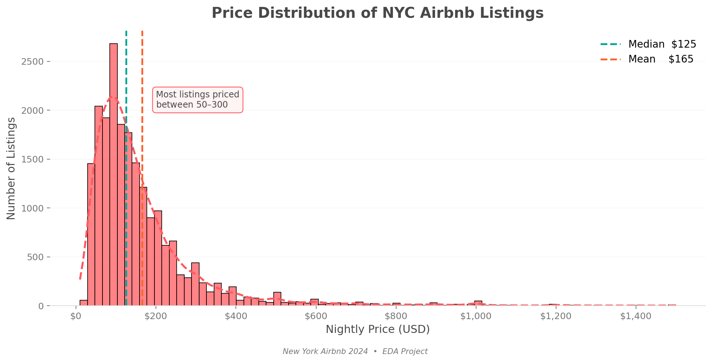
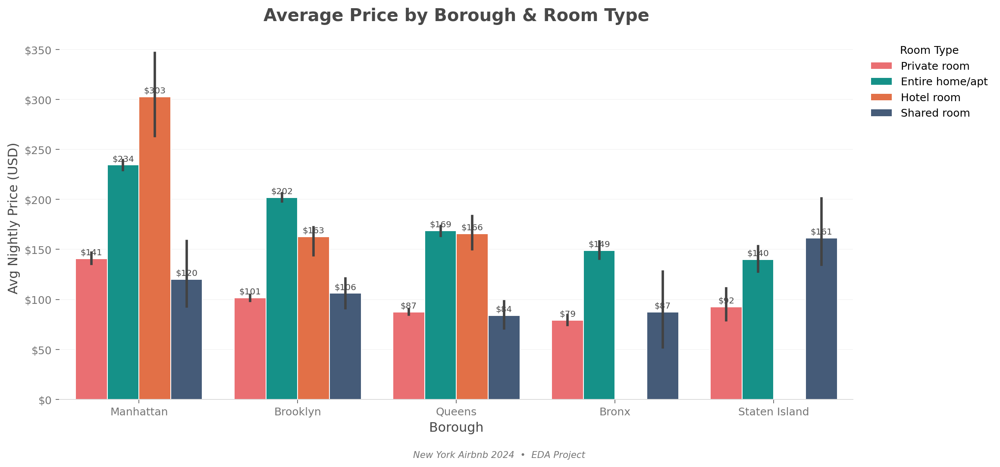
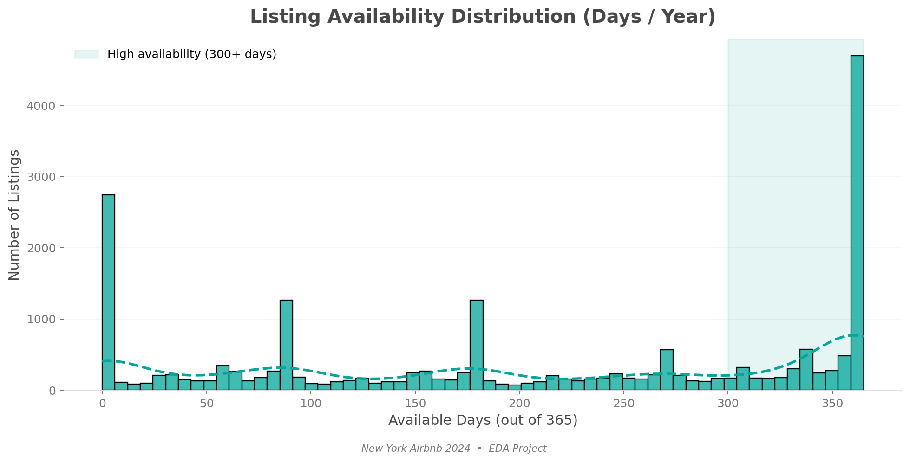
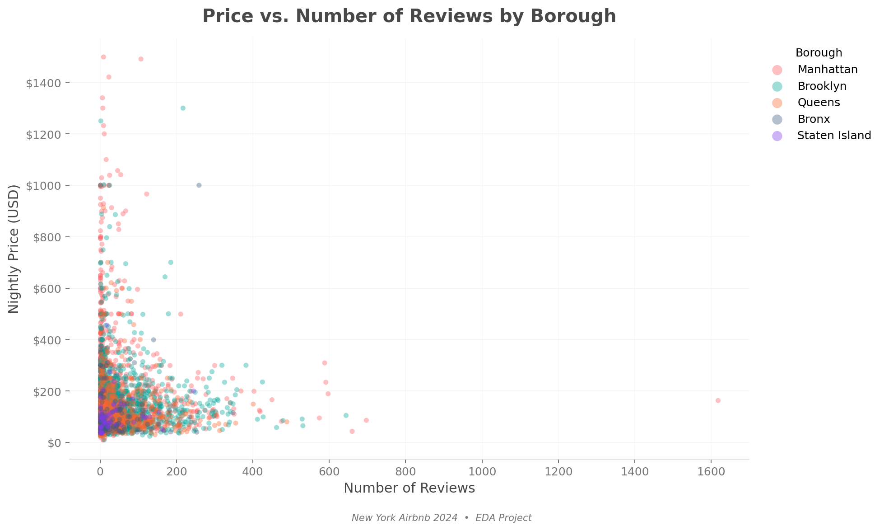
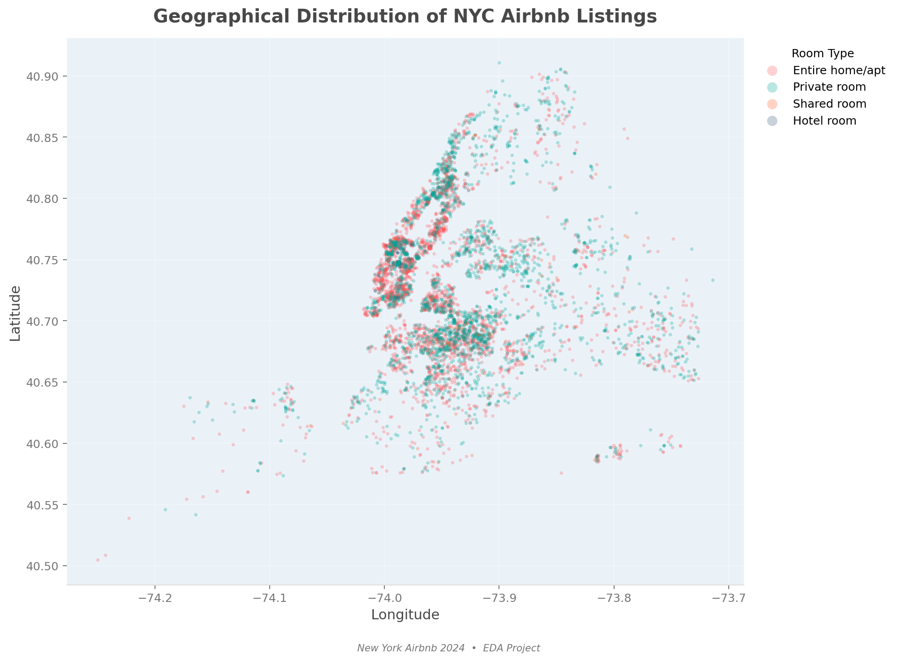
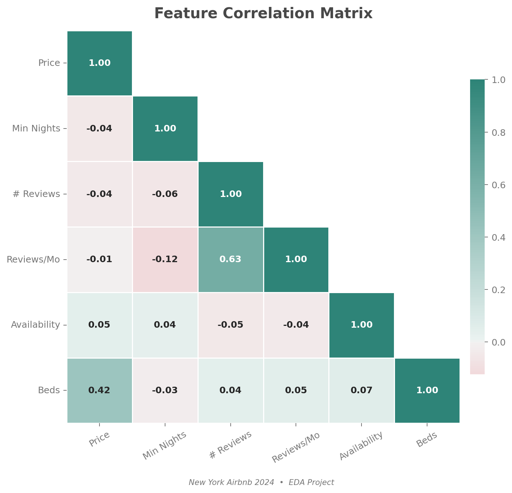
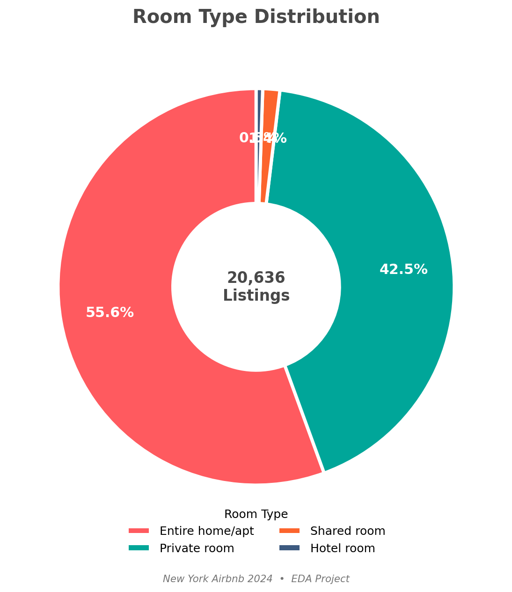
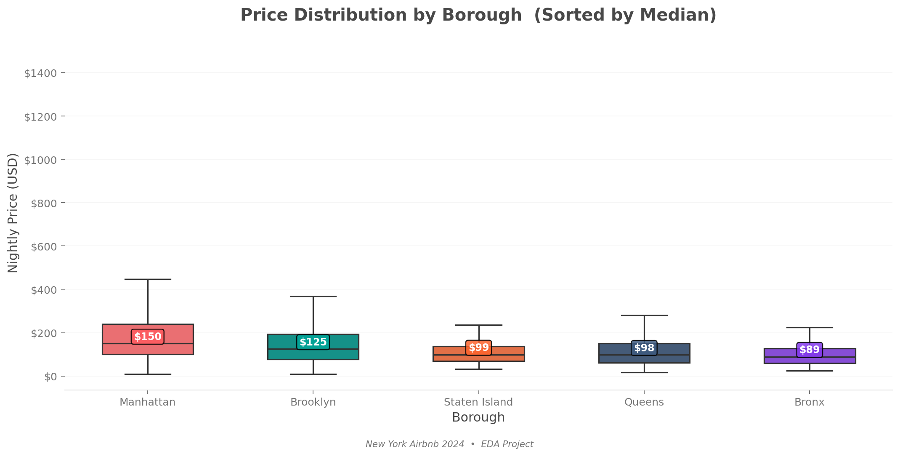

# New York Airbnb 2024: exploratory data analysis


An exploratory analysis of NYC Airbnb listings using pandas, NumPy, Matplotlib, and Seaborn. The notebooks examine nightly prices, room types, boroughs, availability, reviews, and location.

This is the **20,770-row listings project**. My separate [Airbnb cleaning and modeling project](https://github.com/Talhax55z/airbnb-nyc-eda-modeling) uses a different, 102,599-row dataset. Its modeling notebook belongs in that repository.

## Start here

- [Main notebook: day23_note.ipynb](day23_note.ipynb) includes the exploratory work and the code that exports eight presentation charts.
- [Earlier notebook: airbnb.ipynb](airbnb.ipynb) preserves the initial analysis.
- [datasets.csv](datasets.csv) is the input used by both notebooks.

## Data and method

The supplied CSV has **20,770 rows and 22 columns**. Removing rows with any missing value and then exact duplicates leaves **20,724 rows**. Filtering to `price < 1500` leaves **20,636 listings** for the charts. This filters out expensive listings; it does not cap their prices.

The analysis casts listing and host IDs to object type and derives price per bed. Dropping every row with a missing value can change the sample, and the price filter limits the conclusions to the retained listings. The notebooks do not fit a price-prediction model or convert `last_review` to datetime.

## Checked findings

Figures below were recalculated from the supplied CSV using that cleaning and filtering sequence.

| Measure | Result |
|---|---:|
| Median nightly price | $125 |
| Mean nightly price | $165.29 |
| Entire homes/apartments | 55.6% |
| Private rooms | 42.5% |
| Shared rooms | 1.4% |
| Hotel rooms | 0.5% |

Median nightly prices by borough are **$150 in Manhattan**, **$125 in Brooklyn**, **$99 in Staten Island**, **$98 in Queens**, and **$89 in the Bronx**.

These are descriptive results for the supplied sample. Availability is not a direct measure of occupancy, and review counts do not establish guest satisfaction or explain why a listing is expensive.

## Chart gallery

### Prices




### Availability and reviews




### Geography and correlations




### Room types and borough medians




The exported PNGs are the supplied presentation charts. The scatter charts sample up to 4,000 listings for reviews and 6,000 for geography, with fixed random seeds.

## Run locally

```bash
git clone https://github.com/Talhax55z/Air-BNB-1.git
cd Air-BNB-1
python -m venv .venv
```

Activate with `.venv\Scripts\Activate.ps1` in PowerShell or `source .venv/bin/activate` on macOS/Linux. Then:

```bash
python -m pip install -r requirements.txt
jupyter lab day23_note.ipynb
```

Keep `datasets.csv` next to the notebooks, restart the kernel, and run all cells in order. The final cell rewrites the eight chart PNGs. The price-per-bed calculation now runs before its grouped summary.

## Acknowledgments

This work builds on [Zero Analyst / najirh's New York Airbnb 2024 tutorial](https://github.com/najirh/Python-Project-P2-New-York-AirBnb-Listing-2024), referenced in the supplied setup notes. The supplied banner is retained with its original filename. Third-party data and imagery retain their original ownership; this repository does not grant additional rights to them.
